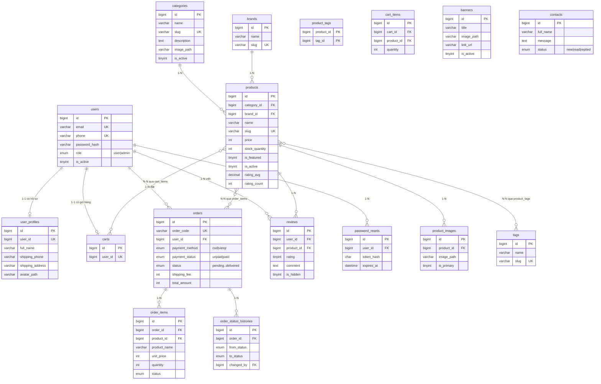

# ERD — BakeHouse

## Quan hệ
| Loại | Bảng |
|---|---|
| 1-1 | `users`–`user_profiles`, `users`–`carts` |
| 1-N | `categories`/`brands` → `products`; `users` → `orders`; `orders` → `order_items`; `products` → `reviews` |
| N-N | `products`–`tags` (`product_tags`), `products`–`carts` (`cart_items`), `products`–`orders` (`order_items`) |

## Quy tắc nghiệp vụ gắn với dữ liệu
- Một admin duy nhất (hoặc nhiều tài khoản role `admin` dùng chung) quản lý toàn bộ sản phẩm và đơn hàng của shop.
- `products.rating_avg/rating_count` được tính lại từ các `reviews` không bị ẩn.
