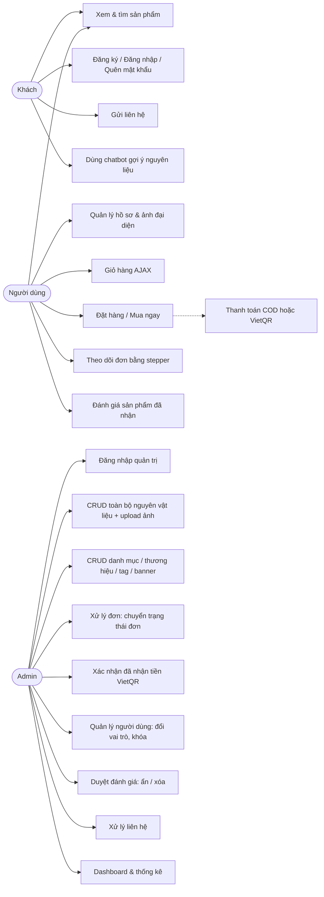

# Use case — BakeHouse



## Luồng đặt hàng
```mermaid
sequenceDiagram
    actor U as Người dùng
    participant W as Website
    participant DB as MySQL
    actor A as Admin
    U->>W: Thêm vào giỏ (AJAX)
    U->>W: Checkout (COD / VietQR)
    W->>DB: BEGIN; khóa sản phẩm; kiểm tồn; trừ kho; tạo order + items + history; COMMIT
    W-->>U: Trang đơn (VietQR: ảnh QR đúng số tiền, nội dung = mã đơn)
    A->>W: Chuyển trạng thái đơn (chỉ tiến)
    W->>DB: Cập nhật trạng thái đơn + các item, ghi lịch sử
    A->>W: Xác nhận đã nhận tiền (VietQR)
    U->>W: Sau khi Delivered → đánh giá (1 lần / sản phẩm)
```
